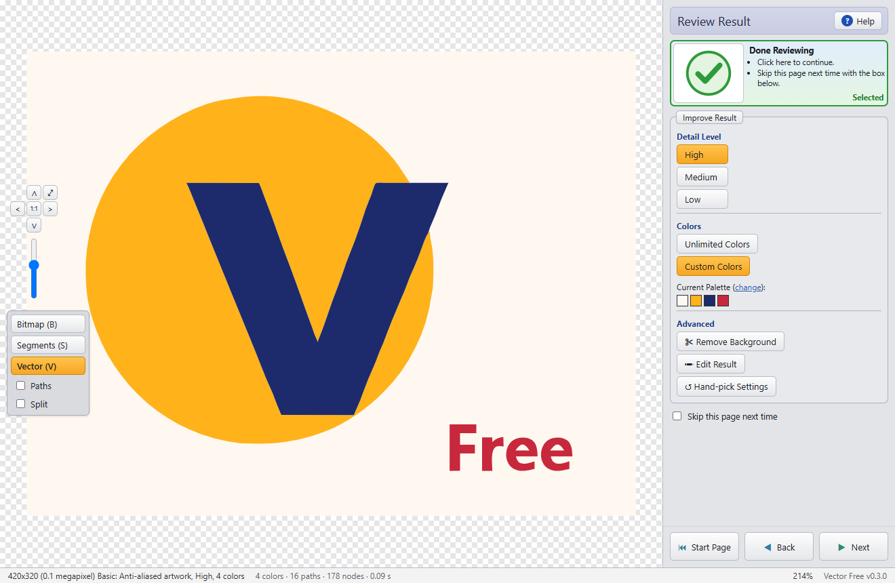
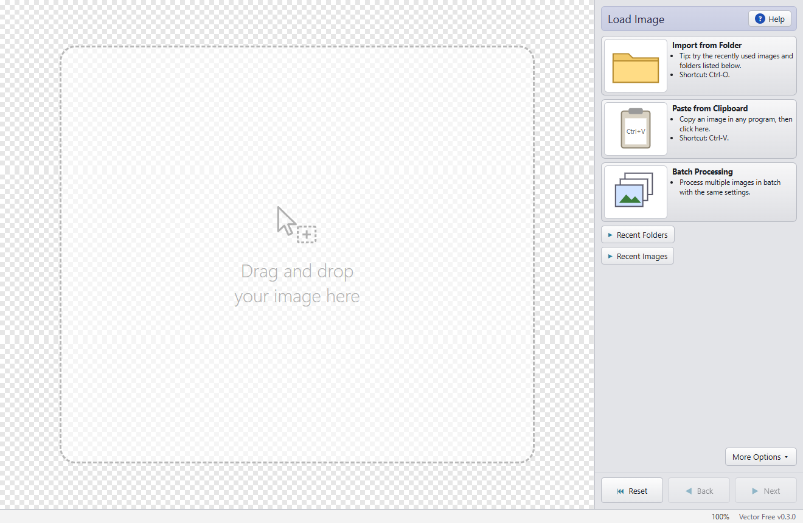
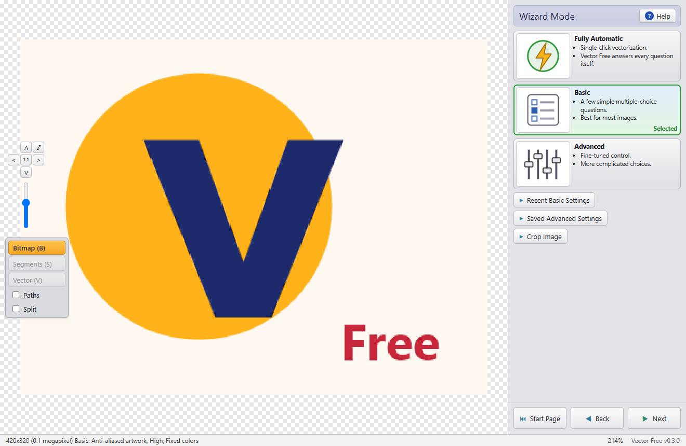
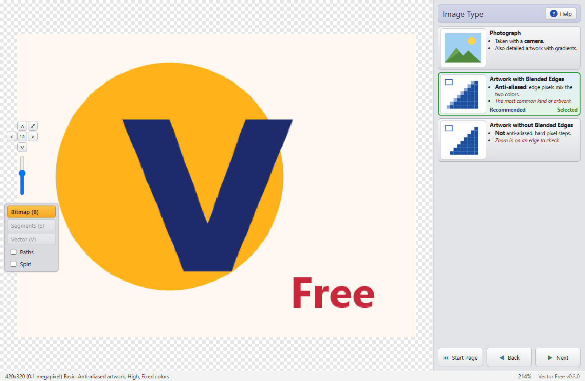
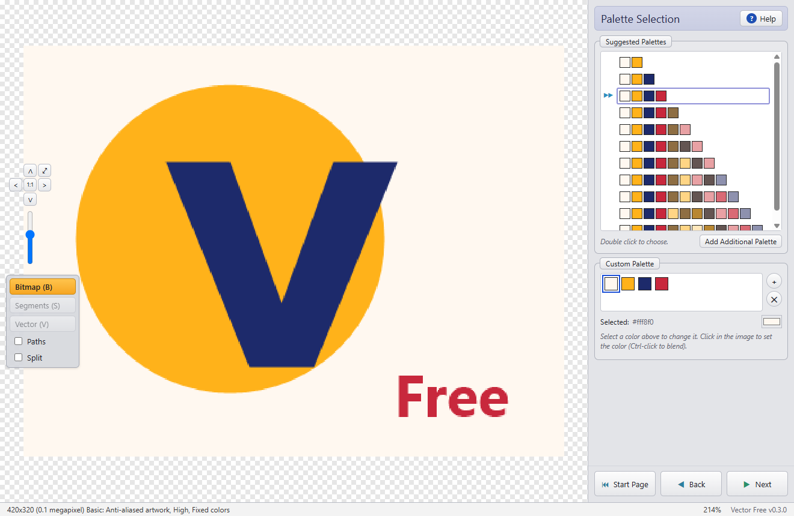
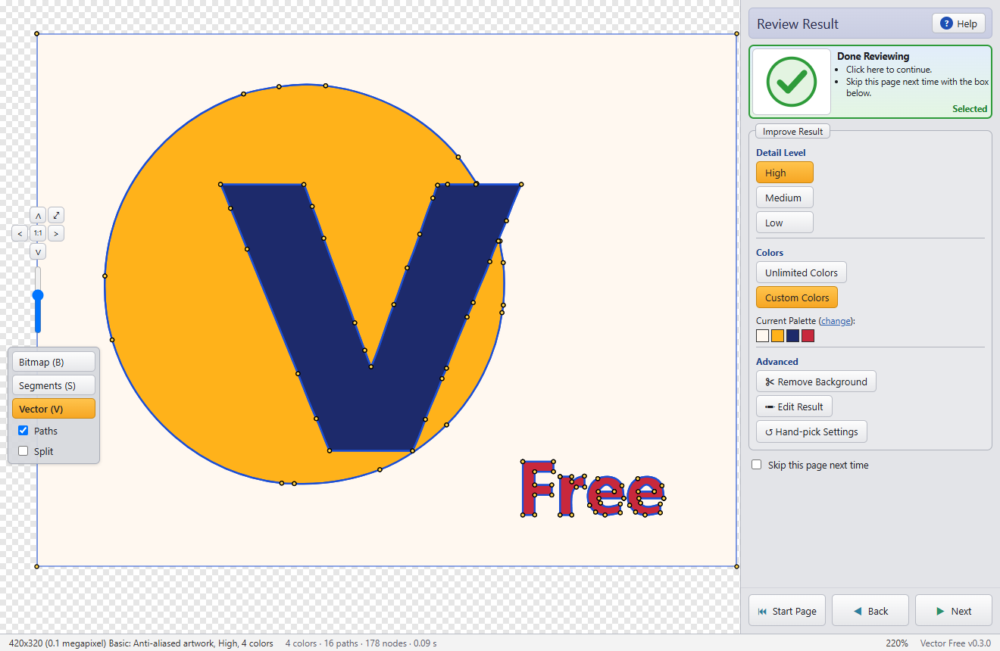
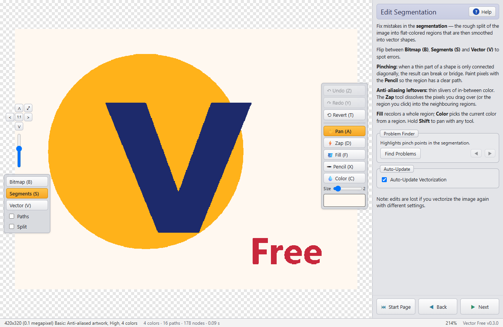
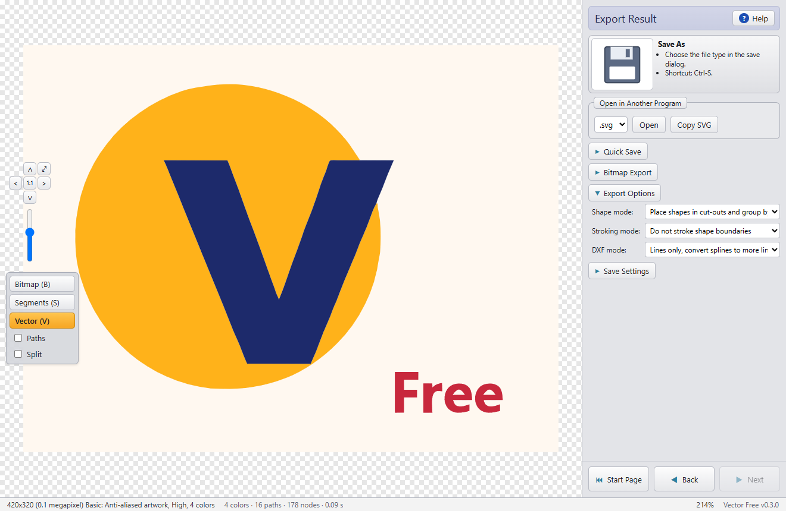

# Vector Free

**Free, open-source bitmap-to-vector tracer.** Vector Free turns raster images — PNG, JPG, GIF, BMP, TIFF, WebP — into clean, scalable vector art you can print at any size, cut on a plotter, embroider, engrave or edit in Illustrator, Inkscape, CorelDRAW or a CAD program.

It works fully automatically in one click, or guides you step by step with a wizard and lets you fix the result by hand. It runs entirely on your computer: no uploads, no account, no watermark.

[**⬇ Download the latest release**](https://github.com/zavants/VectorFree/releases/latest) · Windows 10/11 · portable, no installer



---

## Contents

- [What is it for?](#what-is-it-for)
- [Features](#features)
- [Getting started](#getting-started)
- [Using the wizard](#using-the-wizard)
- [Editing the result](#editing-the-result)
- [Exporting](#exporting)
- [Batch processing](#batch-processing)
- [Command-line tool](#command-line-tool)
- [Keyboard shortcuts](#keyboard-shortcuts)
- [How it works](#how-it-works)
- [Building from source](#building-from-source)
- [Project layout](#project-layout)
- [Known limitations and roadmap](#known-limitations-and-roadmap)
- [Contributing](#contributing)
- [Acknowledgements](#acknowledgements)
- [License](#license)

## What is it for?

A bitmap is a grid of pixels: enlarge it and it gets blurry and jagged. A vector image describes shapes with mathematical curves, so it stays perfectly sharp at any size and every shape can be edited separately.

Typical uses:

- **Logos** that only exist as a small JPG or a screenshot, rebuilt for print, signage or a website.
- **Cutting and engraving**: vinyl cutters, laser cutters and CNC machines need vector outlines (DXF, SVG, AI, EPS).
- **Embroidery and screen printing**: flat color areas with clean edges.
- **Scanned drawings, signatures and stamps**, turned into crisp line art.
- **Illustration styles**: turning a photo into a poster-like, flat-colored drawing.

## Features

### Tracing
- **Fully automatic mode** – detects the image type, quality and colors by itself.
- **Three image types** – photograph, artwork with blended (anti-aliased) edges, artwork without blending (pixel art).
- **Quality / detail level** – how clean the source is (artwork) or how much detail you want (photos).
- **Smart palettes** – automatic, two colors, custom or unlimited; suggested palettes from 2 to 40 colors; eyedropper with color blending; per-color opacity.
- **Sub-pixel accuracy** – anti-aliased edge pixels are used to locate the true edge *between* pixels, so curves are smooth and faithful even on small images.
- **Clean geometry** – neighbouring shapes share exactly the same boundary (no gaps, no overlaps); sharp corners stay sharp; small circles stay round.
- **Advanced controls** – complexity, minimum region size, anti-aliasing artifact rejection, noise filter, smoothness, corner detection, number of nodes, lines-only output.

### Editing
- **Segmentation editor** – Pencil, Fill, Zap and Color tools with undo, redo and revert.
- **Problem finder** – highlights pinch points that can break thin shapes.
- **Remove background** – click shapes (or a whole color) to drop them from the result; click again to restore.
- **Views** – bitmap, segments, vector, paths with nodes, and side by side.
- **Crop** – trace only part of a large image.

### Output
- **Vector**: SVG, PDF, EPS, AI (Illustrator 3), DXF (R12 polylines or DXF 2000 splines).
- **Bitmap**: PNG, GIF, JPEG, BMP, TIFF at any scale.
- **Layouts**: stacked shapes, cut-outs, or cut-outs grouped by color; optional stroking to hide hairline gaps on screen.
- **Copy SVG** to the clipboard, **Quick Save** next to the original, or **open** the result straight in the program associated with the file type.

### Productivity
- **Batch processing** with automatic type detection for every image.
- **Recent images and folders**, **recent and saved settings**.
- **Paste** images from the clipboard, **drag and drop** files onto the window or onto the program icon.
- **Contextual help** on every page (F1).

## Getting started

1. Download `VectorFree-x.y.z-windows-x64-portable.zip` from the [releases page](https://github.com/zavants/VectorFree/releases) and unzip it anywhere (a USB stick works too).
2. Run `VectorFree.exe`. It needs Microsoft Edge WebView2, which is already part of Windows 10 and 11.
3. Load an image (**Import from Folder**, **Ctrl+V** to paste, or drag a file onto the window), choose **Fully Automatic** and click **Next**.

> The executables are not code-signed yet, so Windows SmartScreen may warn the first time. Choose **More info → Run anyway**.



## Using the wizard

The window has the image on the left and the wizard on the right. **Start Page**, **Back** and **Next** move between pages, and **Help** explains the current page.

### 1. Wizard Mode

| Mode | What it does |
|---|---|
| **Fully Automatic** | One click: Vector Free answers every question itself. You can still improve the result afterwards. |
| **Basic** | A few multiple-choice questions. Best for most images. |
| **Advanced** | Direct control over segmentation and path smoothing. |



### 2. Basic questions

- **Image Type** – *Photograph*, *Artwork with Blended Edges* (anti-aliased, the most common) or *Artwork without Blended Edges* (hard pixel steps). The recommended answer is marked.
- **Input Quality** (artwork) – *High* for sharp, clean images; *Medium* for some compression artifacts; *Low* for blurry or noisy images.
  **Detail Level** (photos) – *Low* gives a simplified, cartoon-like look; *High* stays close to the photo.
- **Color Mode** – *Two Colors*, *Custom Colors* (recommended for logos with up to ~12 colors) or *Unlimited Colors* (gradients and photos).
- **Palette Selection** – pick one of the suggested palettes (the recommended one is marked ▶▶), or build your own: select a swatch and click in the image to take that color; Ctrl-click blends colors.




### 3. Review Result

Flip between **Bitmap (B)** and **Vector (V)**, zoom with the mouse wheel, and tick **Paths** to see every outline and node. From here you can change the **Detail Level** or **Colors**, **Remove Background**, **Edit Result** or go back with **Hand-pick Settings**.



### Advanced mode

| Page | Settings |
|---|---|
| **Image Segmentation** | Complexity (fewer ↔ more segments), Minimum Number of Pixels, Anti-Aliasing Artifact Rejection (None / Moderate / Aggressive), Noise Filter, Auto-Update |
| **Edit Segmentation** | The hand-editing tools described below |
| **Path Smoothing** | Smoothness, Detect Sharp Corners, Anti-Aliasing Engine, Number of Nodes, Curve Types (curves or lines only), Auto-Update |
| **Remove Background** | Shape-by-shape removal |

## Editing the result

Vector Free first splits the image into flat-colored regions (the **segmentation**), then smooths those regions into curves. When the automatic segmentation gets something wrong, fix it on the **Edit Segmentation** page:

| Tool | Key | Use |
|---|---|---|
| Undo / Redo / Revert | Z / Y / T | Step through or discard edits |
| Pan | A | Move the view (or hold Shift with any tool) |
| Zap | D | Drag to dissolve pixels into the neighbouring regions; click to dissolve a whole region. Removes anti-aliasing slivers and cuts unwanted bridges. |
| Fill | F | Give a whole region the current color |
| Pencil | X | Paint pixels with the current color (brush size slider) |
| Color | C | Click a region to make its color the current color |

**Problem Finder** marks *pinch points* — places where a region is connected only diagonally, which often breaks or bridges shapes. Visit them with ◀ ▶ and fix them with the Pencil.



## Exporting

| Option | Description |
|---|---|
| **Save As** (Ctrl+S) | Choose the file type in the dialog: SVG, PDF, EPS, AI, DXF, PNG, GIF, JPEG, BMP or TIFF. |
| **Open in Another Program** | Saves a temporary copy and opens it in the program associated with that type. |
| **Copy SVG** | Puts the SVG markup on the clipboard (paste into Inkscape, Illustrator, Figma…). |
| **Quick Save** | Saves next to the original image with the same name. |
| **Bitmap Export** | Renders the vectors to a bitmap at any scale. |
| **Shape mode** | *Stack shapes* (easiest to edit), *cut-outs*, or *cut-outs grouped by color*. |
| **Stroking mode** | Stroke shape boundaries to hide the hairline gaps some viewers draw between shapes. |
| **DXF mode** | *Lines and spline curves* (DXF 2000), or lines only with fewer or more lines (DXF R12, the most compatible). |
| **Save Settings** | Store the current settings under a name to reuse them later. |



## Batch processing

Choose **Batch Processing** on the start page (or drop several files onto the window), add the images, then pick:

- **Settings** – *Fully automatic* (each image is analysed separately) or the current settings.
- **Formats** – any combination of SVG, PDF, EPS, AI, DXF and PNG.
- **Output folder** – next to each image, or a folder of your choice.

Press **Start**; **Stop** finishes the current image and stops.

## Command-line tool

`vectorfree-cli.exe` traces images without opening the app — handy for scripts and large folders.

```bash
vectorfree-cli logo.png -f svg,pdf
vectorfree-cli C:\images -o C:\output -f svg,dxf --dxf-splines
vectorfree-cli scan.jpg -t blended -q low --remove-bg -f eps
vectorfree-cli photo.jpg -t photo -q high -f svg
```

| Option | Meaning |
|---|---|
| `-o, --out <DIR>` | Output folder (default: next to each input) |
| `-f, --format <LIST>` | `svg,eps,pdf,ai,dxf,png,gif,jpg,bmp,tif` |
| `-t, --type <KIND>` | `auto`, `photo`, `blended`, `flat` (default `auto`) |
| `-q, --quality <Q>` | `low`, `medium`, `high` |
| `-c, --colors <N>` | Number of colors (default automatic) |
| `-p, --palette <LIST>` | Fixed palette, e.g. `"#ffffff,#1404ab"` |
| `--remove-bg` | Make the border color transparent |
| `--layout <L>` | `cutout` or `stacked` |
| `--stroke` | Stroke shapes with their fill color |
| `--no-group` | One path per shape instead of per color |
| `--scale <X>` | Scale for bitmap outputs |
| `--dxf-splines` | DXF 2000 with splines instead of R12 polylines |
| `--lines` | Straight segments only |
| `--tolerance`, `--smoothing`, `--corner`, `--min-area` | Fine-tuning |
| `--denoise` / `--no-denoise` | Force the noise filter on or off |

Folders are processed in alphabetical order; the exit code is non-zero if any image failed.

## Keyboard shortcuts

| Keys | Action |
|---|---|
| Ctrl+O / Ctrl+V / Ctrl+S | Open / paste / save as |
| Enter / Backspace | Next / previous page |
| B / S / V / P | Bitmap / segments / vector view / toggle paths |
| 0 / 1 / + / − | Fit / actual size / zoom in / zoom out (or mouse wheel) |
| Z / Y / T | Undo / redo / revert (editing pages) |
| A / D / F / X / C | Pan / zap or erase / fill / pencil / color (editing pages) |
| Shift (hold) | Pan with any tool |
| F1 | Help |

## How it works

1. **Palette** – colors are clustered in the perceptual CIE Lab color space (weighted k-means over a color histogram). For artwork, colors are added until every pixel is explained either by a palette color or as an anti-aliasing blend of two of them, so a small but distinct shape is never lost. For photos, colors are added until the average color error meets the requested detail level.
2. **Segmentation** – each pixel is assigned to a palette color (blend pixels go to the closer of the two colors they mix), thin anti-aliasing fringes are filtered, and regions smaller than a threshold are merged. Small images are supersampled first.
3. **Boundary graph** – region borders are traced along the pixel grid and split into chains between junctions. Each chain separates exactly two regions, so both neighbours use the very same curve.
4. **Sub-pixel edges** – every boundary point is moved to where the original image mixes the two neighbouring colors 50/50 (for transparent edges, where alpha is 50%). This inverts the anti-aliasing and recovers the real edge position, the key idea of Diebel's thesis below.
5. **Fitting** – corners are detected on the pixel grid and rebuilt as sharp intersections of the adjoining straight edges; the rest is smoothed (Taubin smoothing, which does not shrink shapes) and fitted with cubic Bézier curves using Schneider's least-squares algorithm.
6. **Export** – shapes are written as compound paths in the chosen format and layout.

## Building from source

Requirements:

- [Rust](https://rustup.rs) (stable)
- [Node.js](https://nodejs.org) 18 or newer (only for the Tauri CLI)
- Tauri prerequisites for your platform — on Windows: Visual Studio C++ Build Tools and WebView2 ([details](https://tauri.app/start/prerequisites/))

```bash
git clone https://github.com/zavants/VectorFree.git
cd VectorFree

# run the engine tests
cargo test -p vectorfree-engine

# build the command-line tool  -> target/release/vectorfree-cli(.exe)
cargo build --release -p vectorfree-cli

# build the desktop app        -> target/release/VectorFree(.exe)
cd app
npm install
npx tauri build --no-bundle
```

For development, `npx tauri dev` (inside `app/`) runs the app with live-reloaded UI.

## Project layout

```
engine/            Tracing library (no UI)
  src/palette.rs     color clustering, suggested palettes, image-type detection
  src/segment.rs     label map and editing operations (pencil, fill, zap, erase…)
  src/trace.rs       boundary graph and shape assembly
  src/snap.rs        sub-pixel edge recovery from anti-aliasing
  src/fit.rs         corners, smoothing, Bézier fitting
  src/export/        SVG, PDF, EPS/AI, DXF and bitmap writers
  tests/             end-to-end tests
cli/               Command-line front end
app/               Desktop app (Tauri)
  src-tauri/         Rust commands exposed to the UI
  ui/                HTML, CSS and JavaScript of the wizard
docs/screenshots/  Images used in this README
```

## Known limitations and roadmap

- Windows builds only so far; the code is cross-platform but Linux and macOS builds are untested.
- DXF 2000 splines, AI and EPS output have not yet been validated in AutoCAD, Illustrator or CorelDRAW. DXF *lines only* (R12) is the safest choice for CAD/CAM.
- Long straight diagonal edges can come out slightly wavy with too many nodes; improving straight-edge detection is the next engine task.
- The interface is in English only.
- Executables are not code-signed.

Ideas for later: Linux/macOS builds, more languages, centerline (single-stroke) tracing for line art, and drag-and-drop of the result into other programs.

## Contributing

Bug reports and pull requests are welcome. When reporting a tracing problem, attach the input image (if you can share it) and the settings you used. Please run `cargo test -p vectorfree-engine` before sending changes to the engine.

## Authors

- **[zavants](https://github.com/zavants)** – creator and maintainer.
- **Claude** (Anthropic) – collaborator: designed and wrote much of the engine, app and documentation together with zavants, as AI pair programmer. Commits it helped with carry a `Co-Authored-By: Claude` trailer.

## Acknowledgements

- J. Diebel, *Bayesian Image Vectorization: the probabilistic inversion of vector image rasterization*, PhD thesis, Stanford University, 2008 — the idea of using anti-aliasing to recover edge positions.
- P. J. Schneider, *An Algorithm for Automatically Fitting Digitized Curves*, Graphics Gems, 1990.
- G. Taubin, *A signal processing approach to fair surface design*, SIGGRAPH 1995 — shrink-free smoothing.
- Built with [Rust](https://www.rust-lang.org), [Tauri](https://tauri.app), [image](https://crates.io/crates/image) and [tiny-skia](https://crates.io/crates/tiny-skia).

Vector Free's wizard follows the workflow and option names that users of commercial tracers such as Vector Magic are used to, so they can find their way without a manual. Vector Free is an independent project: it contains no code, artwork or text from other products and is not affiliated with them.

## License

Licensed under either of

- Apache License, Version 2.0 ([LICENSE-APACHE](LICENSE-APACHE))
- MIT license ([LICENSE-MIT](LICENSE-MIT))

at your option. Unless you explicitly state otherwise, any contribution you submit for inclusion is dual-licensed as above, without additional terms.
